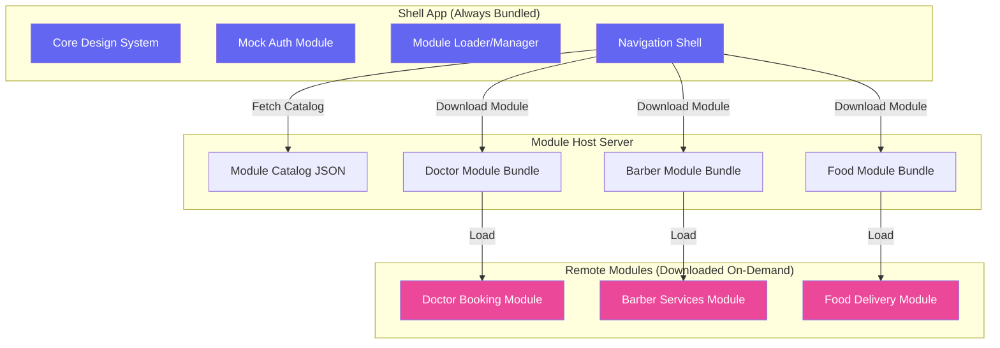
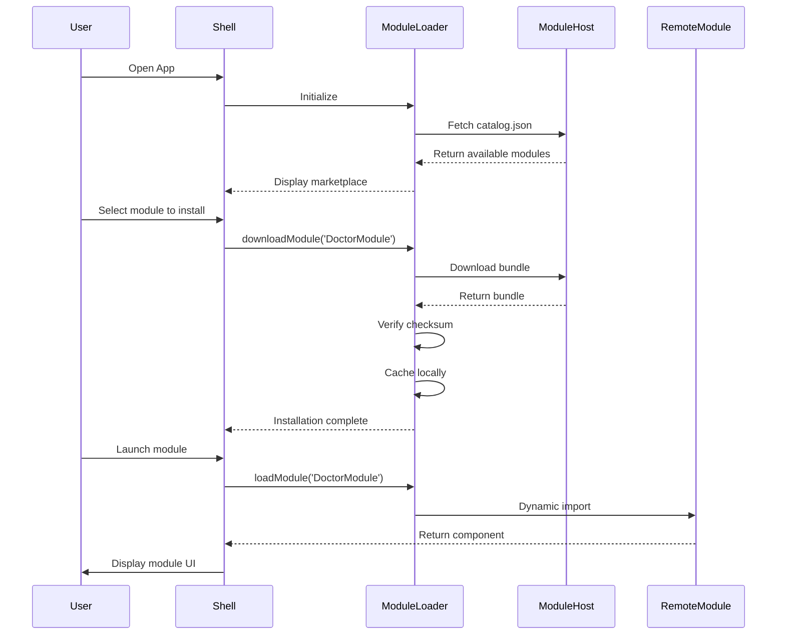

# ServiceHub - On-Demand Module Delivery Platform

**ServiceHub** is a cross-platform mobile application built with **React Native** that demonstrates **on-demand module delivery** using **Re.Pack** and **Module Federation**. The app provides a lightweight shell that dynamically loads service modules (Doctor Booking, Barber Services, Food Delivery) only when needed, keeping the initial app size minimal.

## 🏗️ Architecture

### High-Level Overview



### Module Delivery Flow



## 📦 Bundle Size Breakdown

### Shell App (Core)
- **Estimated Size:** ~850 KB (gzipped)
- **Includes:**
  - Design system & components
  - Auth module
  - Module loader
  - Navigation shell
  - React Native core + dependencies

### Remote Modules (Downloaded On-Demand)
- **Doctor Module:** ~512 KB
- **Barber Module:** ~480 KB
- **Food Module:** ~544 KB

**Key Benefit:** Users only download what they need. Installing all 3 modules still results in a smaller total size than bundling everything upfront.

## 📁 Folder Structure

```
ServiceHub/
├── android/                      # Android native code
├── ios/                          # iOS native code
├── src/                          # Shell app source
│   ├── core/                     # Design system
│   │   ├── theme.ts              # Theme tokens
│   │   └── components/           # Reusable UI components
│   │       ├── Button.tsx
│   │       ├── Card.tsx
│   │       ├── Input.tsx
│   │       └── Text.tsx
│   ├── auth/                     # Authentication module
│   │   ├── types.ts
│   │   ├── authStore.ts          # Zustand store
│   │   └── screens/
│   │       ├── SignInScreen.tsx
│   │       └── SignUpScreen.tsx
│   ├── modules/                  # Module management
│   │   ├── types.ts
│   │   ├── moduleLoader.ts       # Download, cache, load modules
│   │   └── screens/
│   │       ├── ModuleSelectorScreen.tsx
│   │       └── ModuleMarketplaceScreen.tsx
│   └── App.tsx                   # Main app component
│
├── modules/                      # Remote modules (separate builds)
│   ├── doctor/
│   │   └── src/
│   │       ├── data.ts           # Sample doctor data
│   │       ├── store.ts          # Appointment state
│   │       ├── screens/          # Doctor booking UI
│   │       └── index.ts          # Module entry point
│   ├── barber/
│   │   └── src/
│   │       ├── data.ts           # Sample barber data
│   │       ├── store.ts          # Booking state
│   │       └── index.ts          # Module entry point
│   └── food/
│       └── src/
│           ├── data.ts           # Restaurant & menu data
│           ├── store.ts          # Cart & order state
│           └── index.ts          # Module entry point
│
├── module-host/                  # Static file server
│   ├── public/
│   │   └── catalog.json          # Module metadata
│   ├── server/
│   │   └── index.js              # Express server
│   └── package.json
│
├── scripts/                      # Build & publish scripts
│   ├── build-module.js           # Build single module
│   ├── build-all.js              # Build all modules
│   └── publish-module.js         # Update catalog & publish
│
├── __tests__/                    # Unit tests
│   ├── moduleLoader.test.ts
│   └── foodCart.test.ts
│
├── webpack.config.mjs            # Shell webpack config
├── webpack.doctor.config.mjs     # Doctor module config
├── webpack.barber.config.mjs     # Barber module config
├── webpack.food.config.mjs       # Food module config
├── package.json
├── tsconfig.json
└── README.md
```

## 🚀 Getting Started

### Prerequisites

- Node.js >= 22.11.0
- npm or yarn
- Android Studio (for Android development)
- Xcode (for iOS development, macOS only)

### Installation

1. **Clone the repository**
```bash
git clone <repository-url>
cd ServiceHub
```

2. **Install dependencies**
```bash
npm install
cd module-host && npm install && cd ..
```

3. **Build all modules**
```bash
npm run build:all-modules
```

4. **Start the module host server** (in a separate terminal)
```bash
npm run host
```
The server will run on `http://localhost:9000` and serve the module catalog.

5. **Start the shell app** (in another terminal)
```bash
npm start
```

6. **Run on Android or iOS**
```bash
# Android
npm run android

# iOS (macOS only)
npm run ios
```

## 🔧 Development Workflow

### Building Individual Modules

```bash
# Build and publish a specific module
npm run publish:doctor
npm run publish:barber
npm run publish:food
```

### Testing During Development

You can run the shell and module dev servers simultaneously:

```bash
# Terminal 1: Shell app
npm run start:shell

# Terminal 2: Doctor module
npm run start:doctor

# Terminal 3: Barber module
npm run start:barber

# Terminal 4: Food module
npm run start:food

# Terminal 5: Module host
npm run host
```

### Running Tests

```bash
# Run all tests
npm test

# Run specific test file
npm test -- moduleLoader.test.ts

# Type checking
npm run typecheck
```

## ➕ How to Add a New Vertical

Follow these steps to add a new service vertical (e.g., "Salon Services"):

### 1. Create Module Structure

```bash
mkdir -p modules/salon/src/screens
```

### 2. Create Module Files

Create the following files in `modules/salon/src/`:

**data.ts** - Define your data types and sample data
```typescript
export interface SalonService {
  id: string;
  name: string;
  price: number;
  duration: string;
}

export const SERVICES: SalonService[] = [
  // Your sample data
];
```

**store.ts** - Create Zustand store for state management
```typescript
import { create } from 'zustand';
import AsyncStorage from '@react-native-async-storage/async-storage';

interface SalonState {
  bookings: Booking[];
  // ... your state
}

interface SalonActions {
  createBooking: (booking: Booking) => Promise<void>;
  // ... your actions
}

export const useSalonStore = create<SalonState & SalonActions>((set, get) => ({
  // ... implementation
}));
```

**index.ts** - Module entry point
```typescript
import React, { useState } from 'react';
// Import your screens

export const SalonModule: React.FC<{ onBack: () => void }> = ({ onBack }) => {
  // Your module implementation
};

export const getNavigator = () => SalonModule;
export default SalonModule;
```

### 3. Create Webpack Config

Create `webpack.salon.config.mjs`:

```javascript
import path from 'path';
import TerserPlugin from 'terser-webpack-plugin';
import * as Repack from '@callstack/repack';

const dirname = Repack.getDirname(import.meta.url);

export default (env) => {
  const {
    mode = 'development',
    context = path.join(dirname, 'modules/salon'),
    entry = './src/index.ts',
    platform = process.env.PLATFORM,
    minimize = mode === 'production',
    devServer = undefined,
  } = env;

  if (!platform) {
    throw new Error('Missing platform');
  }

  return {
    mode,
    devtool: false,
    context,
    entry,
    resolve: {
      ...Repack.getResolveOptions(platform),
      alias: {
        '@': path.join(dirname, 'src'),
        '@core': path.join(dirname, 'src/core'),
      },
    },
    output: {
      clean: true,
      hashFunction: 'xxhash64',
      path: path.join(dirname, 'build/modules/salon', platform),
      filename: 'index.bundle',
      chunkFilename: '[name].chunk.bundle',
      publicPath: 'http://localhost:9004/', // Use next available port
      uniqueName: 'SalonModule',
    },
    optimization: {
      minimize,
      minimizer: [
        new TerserPlugin({
          test: /\.(jsx?|tsx?)$/,
          extractComments: false,
        }),
      ],
    },
    module: {
      rules: [
        {
          test: /\.[cm]?[jt]sx?$/,
          exclude: /node_modules/,
          use: {
            loader: 'babel-loader',
          },
        },
        Repack.REACT_NATIVE_LOADING_RULES,
      ],
    },
    plugins: [
      new Repack.RepackPlugin({
        context,
        mode,
        platform,
        devServer,
      }),
      new Repack.plugins.ModuleFederationPlugin({
        name: 'SalonModule',
        library: { type: 'var', name: 'SalonModule' },
        filename: 'index.bundle',
        exposes: {
          './Module': './src/index.ts',
        },
        shared: {
          react: {
            singleton: true,
            eager: true,
            requiredVersion: '19.2.3',
          },
          'react-native': {
            singleton: true,
            eager: true,
            requiredVersion: '0.87.1',
          },
          '@react-navigation/native': {
            singleton: true,
            eager: true,
          },
          '@react-navigation/native-stack': {
            singleton: true,
            eager: true,
          },
          zustand: {
            singleton: true,
            eager: true,
          },
        },
      }),
    ],
  };
};
```

### 4. Update Shell Webpack Config

Add the new remote to `webpack.config.mjs`:

```javascript
new Repack.plugins.ModuleFederationPlugin({
  name: 'ServiceHubShell',
  remotes: {
    DoctorModule: 'DoctorModule@http://localhost:9001/[name][ext]',
    BarberModule: 'BarberModule@http://localhost:9002/[name][ext]',
    FoodModule: 'FoodModule@http://localhost:9003/[name][ext]',
    SalonModule: 'SalonModule@http://localhost:9004/[name][ext]', // Add this
  },
}),
```

### 5. Update Module Loader

In `src/modules/moduleLoader.ts`, add the import case:

```typescript
if (moduleId === 'DoctorModule') {
  moduleExport = await import('../../modules/doctor/src');
} else if (moduleId === 'BarberModule') {
  moduleExport = await import('../../modules/barber/src');
} else if (moduleId === 'FoodModule') {
  moduleExport = await import('../../modules/food/src');
} else if (moduleId === 'SalonModule') {
  moduleExport = await import('../../modules/salon/src'); // Add this
} else {
  throw new Error(`Unknown module: ${moduleId}`);
}
```

### 6. Update Scripts

Add build scripts to `package.json`:

```json
{
  "scripts": {
    "start:salon": "PLATFORM=android webpack-cli serve --config webpack.salon.config.mjs --port 9004",
    "build:salon": "node scripts/build-module.js salon",
    "publish:salon": "npm run build:salon && node scripts/publish-module.js salon"
  }
}
```

Update `scripts/build-module.js` and `scripts/publish-module.js` to include 'salon' in `VALID_MODULES`.

### 7. Build and Publish

```bash
# Build the module
npm run build:salon

# Publish to catalog
npm run publish:salon

# Restart module host
npm run host
```

### 8. Test Your Module

1. Open the app
2. Navigate to the Module Marketplace
3. Download your new Salon module
4. Launch it from the Module Selector

## 🌐 Module Hosting in Production

### Option 1: CDN (Recommended)

Deploy module bundles to a CDN like AWS CloudFront, Cloudflare, or Fastly:

1. **Build all modules for production**
```bash
npm run build:all-modules
```

2. **Upload bundles to CDN**
```bash
# Example with AWS S3 + CloudFront
aws s3 sync build/modules/ s3://your-bucket/modules/ --acl public-read
```

3. **Update catalog.json** with CDN URLs
```json
{
  "modules": [
    {
      "id": "DoctorModule",
      "bundleUrl": "https://cdn.yourapp.com/modules/doctor/index.bundle",
      "checksum": "..."
    }
  ]
}
```

4. **Deploy catalog** to a separate endpoint or the same CDN

### Option 2: Self-Hosted Server

Deploy the `module-host` server to a cloud provider:

```bash
cd module-host
npm install --production
npm start
```

Configure environment variables for production:
```bash
export PORT=8080
export NODE_ENV=production
```

### Option 3: Container Deployment

Create a `Dockerfile`:

```dockerfile
FROM node:22-alpine
WORKDIR /app
COPY module-host/package*.json ./
RUN npm ci --production
COPY module-host/ ./
COPY build/modules/ ../build/modules/
EXPOSE 9000
CMD ["npm", "start"]
```

Deploy to Kubernetes, AWS ECS, or other container platforms.

## 📱 App Store Policy Considerations

### Apple App Store (Section 3.3.1 / 4.7)

**Important:** Dynamic code loading is subject to strict policies:

✅ **Allowed:**
- Loading modules that extend the app's **existing purpose**
- Educational content, mini-programs, or games **with App Store review**
- Content updates that don't change the app's primary purpose

❌ **Not Allowed:**
- Downloading code that fundamentally changes the app
- Bypassing App Review
- Executing arbitrary code

**For ServiceHub:**
- All modules extend the **same core purpose**: service booking
- Each module must be **code-signed** and **integrity-checked** (checksum verification)
- The shell app's App Store listing should describe **all possible verticals**

**Recommendations:**
1. Include screenshots of all modules in your App Store listing
2. Implement code signing for production bundles
3. Use HTTPS for all module downloads
4. Consider submitting an initial build with all modules bundled for review, then enabling on-demand delivery post-approval

### Google Play Store

Google Play is generally more permissive:

✅ **Allowed:**
- Dynamic feature modules
- Downloadable content
- In-app updates

**Recommendations:**
1. Declare all permissions upfront
2. Use HTTPS for downloads
3. Implement integrity verification

## 🧪 Testing

### Unit Tests

Run Jest tests:
```bash
npm test
```

### Integration Tests

Test module loading flow:
```bash
npm run test -- --testPathPattern=moduleLoader
```

### Manual Testing Checklist

- [ ] Sign in / Sign up flows
- [ ] Guest mode access
- [ ] Module marketplace loads catalog
- [ ] Download progress shows correctly
- [ ] Module installs successfully
- [ ] Module launches and functions
- [ ] Remove module works
- [ ] Offline mode handles gracefully
- [ ] Doctor booking flow (list → detail → book → appointments)
- [ ] Barber booking flow (shops → services → barbers → time → confirm)
- [ ] Food ordering flow (restaurants → menu → cart → checkout → orders)

## 🔐 Security Best Practices

1. **HTTPS Only**: Always serve modules over HTTPS in production
2. **Checksum Verification**: Verify bundle integrity before loading
3. **Code Signing**: Sign production bundles (future enhancement)
4. **Versioning**: Enforce min/max version compatibility
5. **Rate Limiting**: Protect the module host from abuse
6. **Authentication**: Consider requiring auth for module downloads

## 🛠️ Tech Stack

- **React Native**: 0.87.1
- **React**: 19.2.3
- **Re.Pack**: For Module Federation
- **Webpack**: Module bundler
- **Zustand**: State management
- **AsyncStorage**: Local persistence
- **React Navigation**: Navigation
- **TypeScript**: Type safety
- **Jest**: Testing

## 📄 License

MIT License - see [LICENSE](./LICENSE) file for details.

## 🤝 Contributing

Contributions are welcome! This is a portfolio/demo project showcasing on-demand module delivery architecture.

## 📞 Support

For questions or issues, please open a GitHub issue.

---

**Built with ❤️ as a demonstration of modern React Native architecture patterns**
